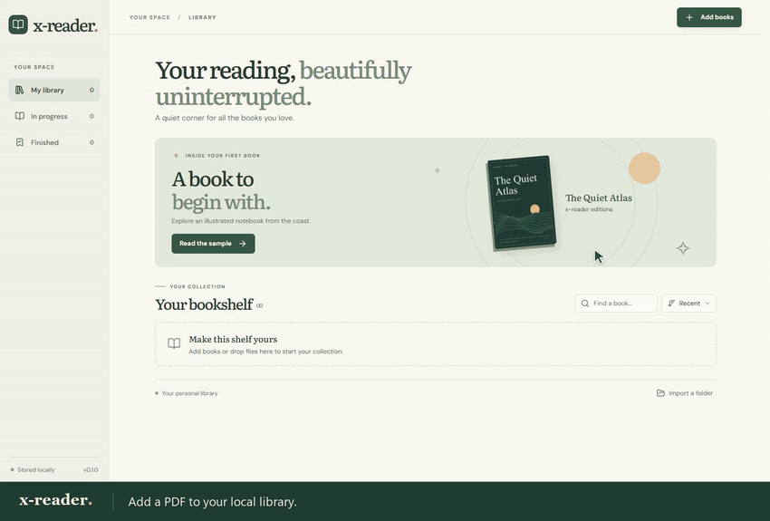
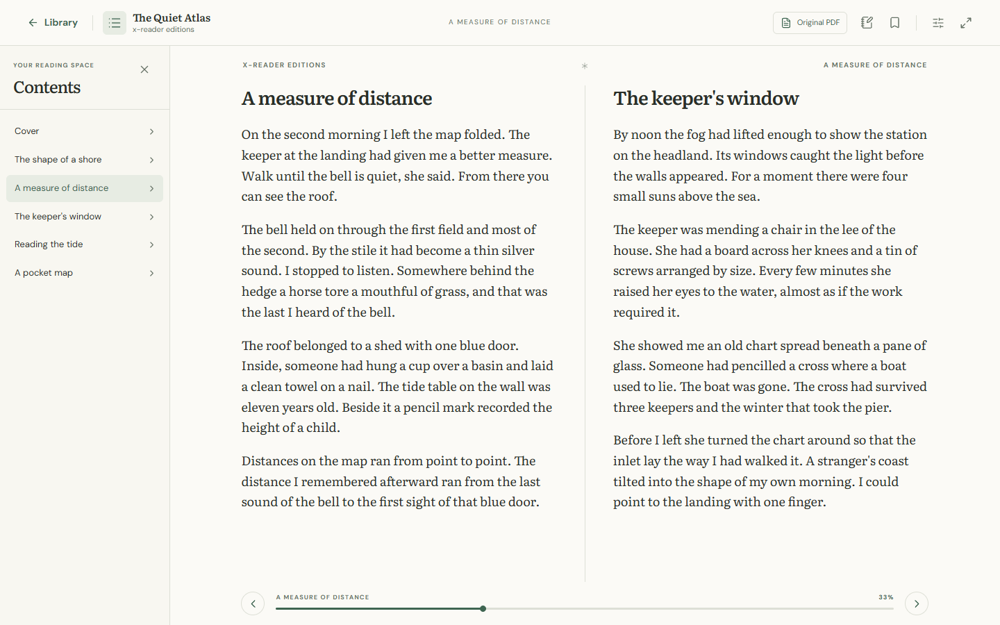
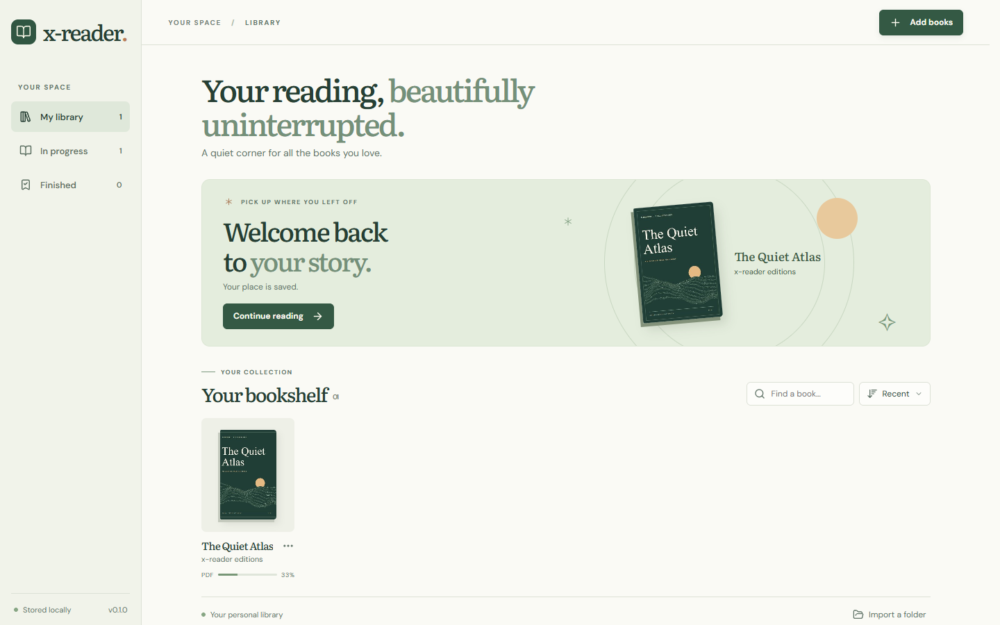

<p align="center"></p>
<h1 align="center">x-reader</h1>
<p align="center"><strong>Your books, in a layout that fits you.</strong><br>Read a PDF like an ebook. Switch back to the printed page whenever you need it.</p>
<p align="center"><a href="https://github.com/realsaraf/x-reader/releases/latest"><strong>Download x-reader</strong></a> &nbsp; · &nbsp; <a href="https://raw.githubusercontent.com/realsaraf/x-reader/main/docs/media/demo.mp4">Watch the 24-second demo</a> &nbsp; · &nbsp; <a href="#build-from-source">Build from source</a></p>

[](https://raw.githubusercontent.com/realsaraf/x-reader/main/docs/media/demo.mp4)

*The walkthrough uses x-reader’s browser preview and the bundled sample PDF. The desktop app uses the same reading interface with a Rust-backed library.*

x-reader is a local-first desktop reader built with Rust and Tauri. Add your own books or open *The Quiet Atlas*, an illustrated field notebook included with the app. Books, original files, notes and reading positions stay on your device. Fonts and PDF rendering resources ship with the application.

## Download

| Platform | Install | Take your library with you |
| --- | --- | --- |
| Windows x64 | Run the **setup.exe** | Extract the **portable.zip** to a writable folder and start `x-reader.exe`. Keep the marker file and `data` folder together. |
| macOS 15+ · Apple Silicon and Intel | Open the **universal .dmg** and drag x-reader to Applications | Extract the **macOS portable ZIP** to a writable folder. Keep the app, portable marker and library together. |

Each release includes SHA-256 checksums. Windows uses Microsoft Edge WebView2. The Windows installer can fetch it on first setup. The portable Windows executable uses the runtime on the destination PC. The Windows builds are unsigned. The macOS builds use an ad hoc signature and are distributed without Apple notarization. See the release guide for first launch and portable storage details. [Downloads](https://github.com/realsaraf/x-reader/releases/latest) · [Release guide](docs/RELEASING.md)

## Inside the reader



- **Two ways to read a PDF.** Import builds a local reading edition and preserves the source bytes. The first switch to **Original PDF** follows the current source page. After that, each view remembers its own place.
- **A page you can adjust.** Choose a single page or a two-page spread, five paper colors, four typefaces, text size, line spacing and reading width. The spread adapts when the window gets narrower.
- **A notebook for each book.** Bookmark a spread or an original PDF page. Select reflowed text to highlight a passage or attach a note. Notebook entries take you back to the passage.
- **A shelf that remembers.** Import files or a folder, find books by title or author, and pick up where you left off. Identical files share one library entry even when their filenames differ.

<details>
<summary>See the bookshelf</summary>



</details>

### Formats

| Files | What the reader uses |
| --- | --- |
| PDF | Selectable text reflows into paragraphs. Embedded illustrations and image-only pages are retained. Original PDF mode renders the source at any time. |
| EPUB 2 and 3 | Spine order, chapter navigation, publisher headings and supported embedded images. |
| MOBI, AZW, AZW3 | DRM-free Mobipocket and Kindle Format 8 books. |
| FB2, FB2.ZIP, DOCX | Document structure, text and supported embedded images. |
| CBZ | Image pages in reading order. |
| TXT, Markdown, HTML, XHTML | Local prose, headings and supported formatting. |

Reflow quality depends on how a PDF encodes its reading order. Original PDF mode is useful for precise tables, equations, diagrams and unusual column layouts. Scans without a text layer display as images. OCR, DRM-protected books and password-locked PDFs are outside this release. Files may be up to 128 MiB each.

## Build from source

Install Node.js 24, stable Rust and the native prerequisites for your operating system. On Windows, include MSVC C++ Build Tools and WebView2. On macOS, install Xcode Command Line Tools. [Tauri prerequisites](https://v2.tauri.app/start/prerequisites/)

```sh
git clone https://github.com/realsaraf/x-reader.git
cd x-reader
npm ci
npm run tauri -- dev
```

| Command | Result |
| --- | --- |
| `npm run dev` | Open the web interface for frontend development. The browser preview uses its own IndexedDB library. |
| `npm test` | Run importer and reading-location unit tests. |
| `npm run test:e2e` | Exercise file import, both PDF views, bookmarks, saved settings and bookshelf actions. Windows uses Edge. macOS uses Playwright WebKit (`npx playwright install webkit`). |
| `cargo test --manifest-path src-tauri/Cargo.toml --locked` | Check native storage transactions and portable mode. |
| `npm run tauri -- build` | Compile the frontend and build the native app for the host platform. |

## Project layout

| Directory | Responsibility |
| --- | --- |
| `src/importers/` | Decode books into chapters, normalize text, resolve local illustrations and sanitize content before it reaches the reader. |
| `src/reader/` | Paginate the text, map character offsets to visible spreads, render original PDF pages and manage annotations. |
| `src/library/` | Import files, deduplicate by SHA-256, filter the shelf and resume books. |
| `src/storage/` | Connect the interface to the native library or the browser preview. |
| `src-tauri/src/` | Rust desktop host, bounded application commands, SQLite transactions and portable library discovery. |
| `tests/` | User journeys exercised against the running interface. |

The native library stores each original file and its reading edition in the same transaction. The shelf stores reading state separately, so turning a page does not rewrite the document. A reflow bookmark records a chapter and character offset, which survives changes to font size and window width. A print bookmark records the source page.

## Contributing and releases

Bug reports are especially helpful when they include the file format, operating system, steps to reproduce and a small redistributable sample. For a new format, add an importer and a fixture that checks the resulting text, images or chapter order. For a reader change, exercise it after resizing and reopening a book. [Open an issue](https://github.com/realsaraf/x-reader/issues)

Maintainers choose when to publish. Bump the version, push it to `main`, then open **Actions → Release x-reader → Run workflow**. The release workflow builds the installers and portable downloads, verifies checksums and can publish immediately or prepare a draft. [Release instructions](docs/RELEASING.md)

x-reader and its original sample book are MIT licensed. Third-party code, fonts and rendering resources retain their own licenses. [MIT license](LICENSE) · [Third-party notices](THIRD-PARTY-NOTICES.txt)
